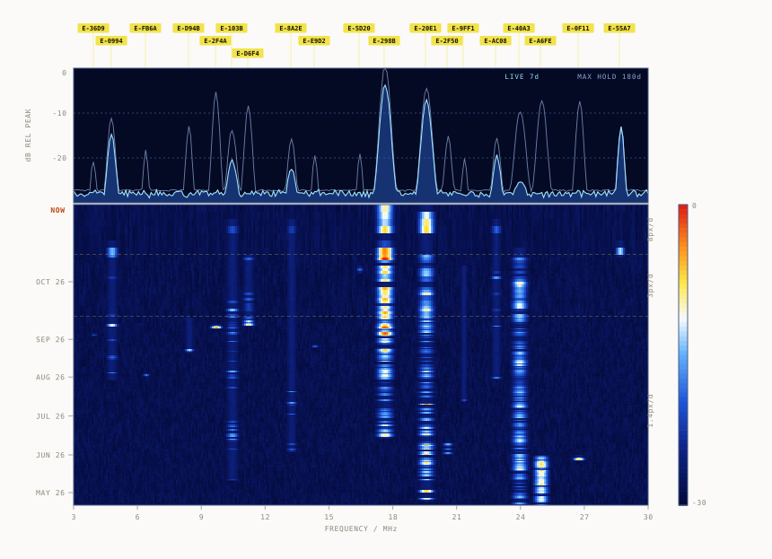

```math
\begin{array}{cccccccccc}
55023 & 27385 & 17551 & 36522 & 95651 & 88577 & 88571 & 57633 & 33475 & 48337 \\
77859 & 15949 & 79355 & 09662 & 20275 & 32772 & 07341 & 19936 & 04026 & 14401 \\
06301 & 35897 & 94607 & 19500 & 72565 & 38136 & 99342 & 27953 & 63928 & 36234 \\
93341 & 66836 & 35380 & 01867 & 89786 & 72469 & 72796 & 04307 & 91510 & 91416 \\
38115 & 24184 & 50004 & 34644 & 05201 & 80499
\end{array}
```

```math
\small c_i \equiv p_i + k_i \pmod{10} \qquad k = \mathrm{SHA256}(s \,\|\, i) \bmod 10
```

<sub>180 d survey · 19 emitters · regenerated nightly</sub>
