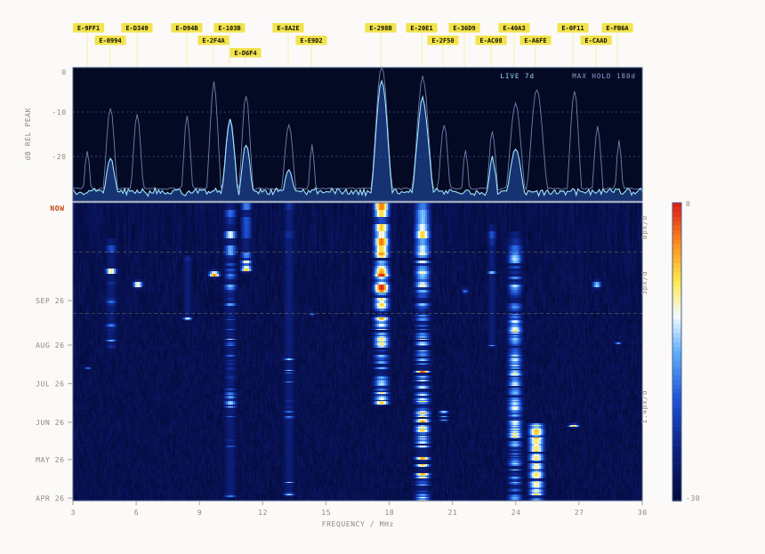

```math
\begin{array}{cccccccccc}
55994 & 29976 & 51435 & 14882 & 35825 & 21756 & 30540 & 39882 & 97635 & 90070 \\
95179 & 81009 & 51814 & 87679 & 08216 & 81839 & 49381 & 25728 & 58374 & 95621 \\
73994 & 41432 & 07846 & 25639 & 20936 & 26859 & 49647 & 77169 & 73779 & 40375 \\
52341 & 00391 & 05520 & 13682 & 42203 & 83577 & 93384 & 81441 & 91188 & 98555 \\
97363 & 19371 & 24953 & 89011
\end{array}
```

```math
\small c_i \equiv p_i + k_i \pmod{10} \qquad k = \mathrm{SHA256}(s \,\|\, i) \bmod 10
```

<sub>180 d survey · 19 emitters · regenerated nightly</sub>
