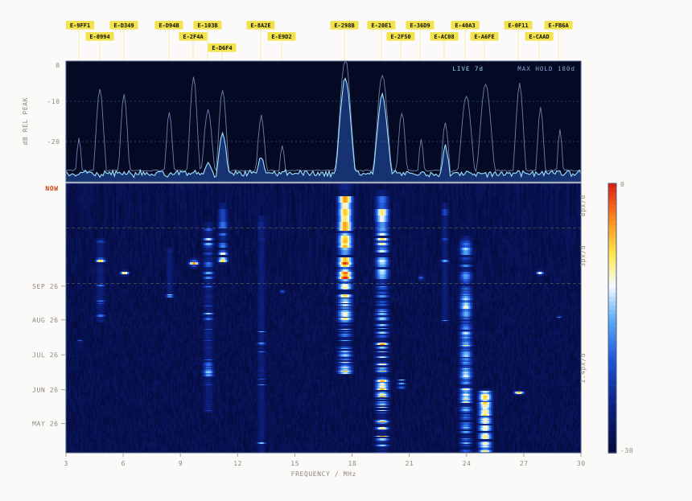

```math
\begin{array}{cccccccccc}
55023 & 27385 & 17551 & 36522 & 95651 & 88577 & 88571 & 57633 & 33475 & 48337 \\
77859 & 15949 & 79355 & 09662 & 20275 & 32772 & 07341 & 19936 & 04026 & 14401 \\
06301 & 35897 & 94607 & 19500 & 72565 & 38440 & 03368 & 56970 & 64140 & 83230 \\
59581 & 26857 & 02537 & 92943 & 99997 & 50536 & 71756 & 64006 & 23460 & 48015 \\
78216 & 82887 & 72892 & 71943
\end{array}
```

```math
\small c_i \equiv p_i + k_i \pmod{10} \qquad k = \mathrm{SHA256}(s \,\|\, i) \bmod 10
```

<sub>180 d survey · 20 emitters · regenerated nightly</sub>
